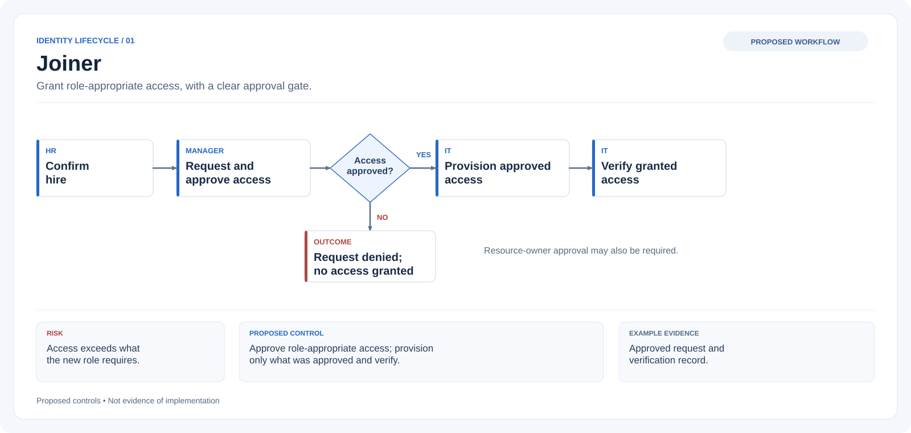
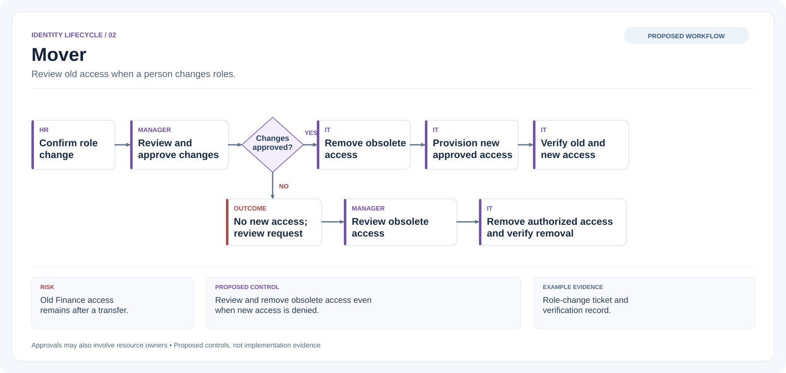
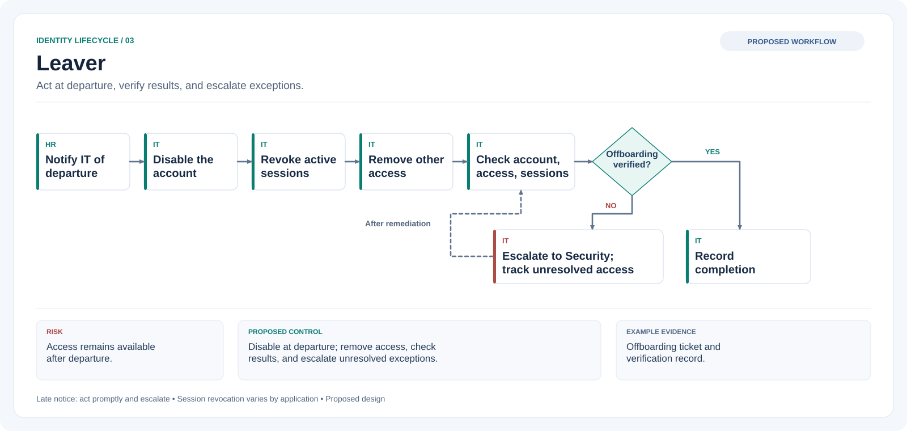

# Identity Lifecycle: Joiner, Mover, Leaver Workflow

> **Project type:** IAM workflow design | **Status:** Proposed controls, not an implemented or tested system

## Overview

This portfolio project maps how an organization could manage access as people join, change roles, and leave. It makes ownership, approval decisions, access changes, verification, and exception handling visible across the identity lifecycle.

### Joiner

### Mover

### Leaver

## Business problem

Access needs change over time. Excessive access at onboarding, permissions retained after a transfer, and delayed offboarding can expose data and systems. A documented process helps teams identify who should act, which approvals are needed, and how completion should be checked.

## Workflow and design decisions

| Lifecycle | Proposed process | Risk addressed |
| --- | --- | --- |
| **Joiner** | HR confirms the hire; the manager requests and approves access; IT grants approved access and verifies it. Denied requests do not lead to provisioning. | Excessive or unapproved access |
| **Mover** | HR confirms the role change; the manager reviews access changes; IT removes obsolete access, grants approved new access, and verifies both. If new access is denied, obsolete access is still reviewed and access authorized for removal is removed and checked. | Accumulation of obsolete access, such as retained Finance permissions |
| **Leaver** | HR notifies IT; IT disables the account, revokes sessions, removes remaining access, and verifies offboarding. Failed verification is escalated to Security, tracked, and checked again after remediation. | Access remaining available after departure |

Depending on the resource and policy, an application or data owner may also need to approve access.

For offboarding, the proposed timing is to disable access at the effective departure time; late notice should prompt timely action and escalation. Actual service levels and emergency procedures would need organizational approval.

## Evidence and scope

The diagram and its risk-and-control callouts are the **design artifacts** produced for this project. They are not proof that a control ran, that access was removed, or that a live tenant was tested. In a real implementation, examples of evidence could include approved access requests, role-change tickets, offboarding tickets, and verification records. No production identities, tenant details, or customer data are included in the diagram.

## Automation opportunities and limits

A future implementation could use authoritative HR events and identity lifecycle tooling to trigger approved provisioning or offboarding tasks and record their outcomes. Automation can reduce repetitive manual work and delays, but it depends on accurate source data, correct scope and timing, and monitored execution. Managers remain responsible for access decisions; IT and Security should review failures, exceptions, and verification evidence. Session revocation behavior varies by application, so it should not be assumed that every session ends immediately.

Microsoft Entra Lifecycle Workflows is one possible tool to investigate; Microsoft documents licensing requirements for that feature. **No automation was configured or tested in this project.** Verify licensing before using licensed features.

## Learnings and next steps

- Least privilege requires defining and verifying what the role needs—not simply granting a standard bundle.
- Role changes require reviewing old access even when a request for new access is denied.
- Offboarding needs timing, ownership, escalation, and re-verification—not just an account-disable action.
- Next: study the official SC-300 materials, validate licensing, then plan a separate authorized test-tenant implementation and capture sanitized evidence of actual results.

## Official Microsoft resources

- [SC-300 study guide](https://learn.microsoft.com/en-us/credentials/certifications/resources/study-guides/sc-300)
- [Implement an identity management solution using Microsoft Entra ID](https://learn.microsoft.com/en-us/training/paths/implement-identity-management-solution/)
- [What are Lifecycle Workflows?](https://learn.microsoft.com/en-us/entra/id-governance/what-are-lifecycle-workflows)
- [Configure delegation using administrative units](https://learn.microsoft.com/en-us/training/modules/implement-initial-configuration-of-azure-active-directory/5-configure-delegation-administrative-units)

## Repository contents

- `01-joiner.svg`, `02-mover.svg`, `03-leaver.svg` — coordinated vector workflow diagrams
- `iam-jml-workflow.svg` — previous combined overview, retained for reference
- The original draw.io source is retained separately and is not included in this package.
